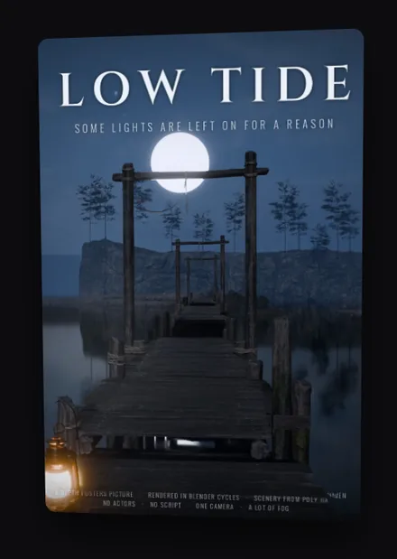
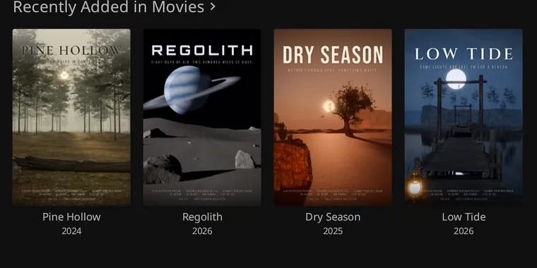

# jellyfin-depth-posters

3D parallax posters for Jellyfin. Hover a poster and it tilts and its layers drift at different speeds, a bit like the app icons on Apple TV.

A small service generates a depth map for every movie and series poster in your library. A Jellyfin plugin then renders the effect in the web UI with WebGL. Everything runs locally; nothing leaves your network except the one-time model downloads.

<p align="center">
  
</p>

In the library, every poster that has been processed reacts to the pointer:



<sub>The posters in the demo are [our own renders](tools/sample-posters/) and are CC0.</sub>

> **Status:** an experiment that works. Developed against **Jellyfin 12.1** and also run on 12.4. Other versions are untested.

## How it works

```
Jellyfin ──(API key, read-only)──▶ jellyfin-depth-posters service ──▶ ./data/<itemId>/<imageTag>/
    ▲                                     (depth model, optional layers)
    │  /DepthPosters/…  (proxied by the plugin)
Browser  ◀── Depth Posters plugin (script + proxy) 
```

1. The **service** scans your library on a schedule, downloads each poster, and runs [Depth Anything V2](https://github.com/DepthAnything/Depth-Anything-V2) on the CPU to produce a depth map. Optionally it also cuts the poster into four layers and fills in what each layer hides with [LaMa](https://github.com/advimman/lama) inpainting.
2. The **plugin** injects a small script into the Jellyfin web UI (through the [File Transformation](https://github.com/IAmParadox27/jellyfin-plugin-file-transformation) plugin) and proxies the generated files, so the browser only talks to Jellyfin.
3. On hover, the script draws the poster in a WebGL canvas over the card. Items without depth data are left alone.

Output is keyed by item ID and poster tag, so a changed poster is regenerated automatically and removed items are cleaned up.

## Requirements

- Jellyfin 12.1 in Docker (the service reaches it over a shared Docker network)
- The [File Transformation](https://github.com/IAmParadox27/jellyfin-plugin-file-transformation) plugin installed in Jellyfin
- A Jellyfin API key
- A CPU with a few cores. No GPU needed (and none is used).

## Quick start

**1. Run the service**

```bash
git clone https://github.com/maxbengtzen/jellyfin-depth-posters.git
cd jellyfin-depth-posters
cp .env.example .env
```

Edit `.env`: create an API key in Jellyfin (*Dashboard → Advanced → API Keys*), set `JELLYFIN_API_KEY`, and set `JELLYFIN_NETWORK` to the Docker network Jellyfin runs on (`docker network ls`). Then:

```bash
docker compose up -d
docker compose logs -f
```

The first scan starts immediately. Generation takes a while on a large library (see [timings](docs/how-it-works.md#performance)). Progress is in the logs, and in `/api/status` if you [publish a port](docs/configuration.md#publishing-a-port-optional).

**2. Install the plugin**

In Jellyfin: *Dashboard → Plugins → Repositories → Add*, and enter

```
https://raw.githubusercontent.com/maxbengtzen/jellyfin-depth-posters/main/manifest.json
```

Then install **Depth Posters** from the catalogue and restart Jellyfin. Prefer to install manually? See [docs/plugin.md](docs/plugin.md).

**3. Check the plugin settings** (*Dashboard → Plugins → Depth Posters*). The default service URL, `http://jellyfin-depth-posters:8000`, works when both containers share a Docker network. Reload the web UI (Ctrl+Shift+R) and hover a poster that has been processed.

## Models and layers

| `DEPTH_MODEL` | Speed (8 CPU cores, per poster) | License |
|---|---|---|
| `small` (default) | ~1.3 s | Apache-2.0 |
| `base` | ~3 s | **CC-BY-NC-4.0** (non-commercial) |
| `large` | ~10 s | **CC-BY-NC-4.0** (non-commercial) |

The models are downloaded on first use and are not part of this repository. If you use `base` or `large` you are bound by their non-commercial license. The depth maps from all three were close in our tests; `small` is a good default for posters that are shown small.

`ENABLE_LAYERS=true` additionally cuts each poster into four layers and inpaints what is behind the nearer ones, so the foreground can move without stretching. It is a more convincing 3D effect but roughly five times slower. See [docs/how-it-works.md](docs/how-it-works.md).

## Documentation

- [Configuration](docs/configuration.md): all settings
- [How it works](docs/how-it-works.md): pipeline, file layout, performance
- [Plugin](docs/plugin.md): installation, settings, how it hooks into Jellyfin
- [Playground](docs/playground.md): try the effect on your own images without Jellyfin
- [Troubleshooting](docs/troubleshooting.md)

## Known limitations

- Text on top of people follows the person (the depth model sees it as part of the surface), while text over the background sits at the background's depth.
- Only the *Primary* image (poster) of movies and series is processed.
- The plugin assumes Jellyfin is served from the web root, not under a base path such as `/jellyfin`.
- The service's API has **no authentication**. Do not expose it to the internet; the plugin proxies it, so it never needs to be published.
- Touch devices are not supported (there is no hover).

## Security

The service needs a Jellyfin API key, which is read from the environment. It is not written to disk or logged. Keep `.env` out of version control (it is git-ignored here). The service only reads from Jellyfin and writes to its own `data` and `cache` volumes.

## Development

```bash
# service tests (inside the image)
docker build -t jellyfin-depth-posters:local service
docker run --rm --entrypoint sh -v "$PWD/service:/app" jellyfin-depth-posters:local \
  -c 'pip install -q -r requirements-dev.txt && python -m pytest -q'

# plugin build (needs the .NET 10 SDK, or use Docker)
cd plugin && dotnet publish -c Release -o dist
```

Local-only settings (build from source, extra ports, extra networks) belong in `compose.override.yaml`, which is git-ignored and picked up automatically by Docker Compose.

## Credits and licenses

This project is MIT licensed. It builds on:

- [Depth Anything V2](https://github.com/DepthAnything/Depth-Anything-V2) (Small: Apache-2.0; Base/Large: CC-BY-NC-4.0)
- [LaMa](https://github.com/advimman/lama) inpainting (Apache-2.0); the weights are fetched from [simple-lama-inpainting](https://github.com/enesmsahin/simple-lama-inpainting)
- [File Transformation](https://github.com/IAmParadox27/jellyfin-plugin-file-transformation) for injecting the script into Jellyfin
- PyTorch, Hugging Face Transformers, FastAPI

Movie posters are copyrighted by their owners. This project does not ship any; it only processes the ones already in your own Jellyfin library. The [sample posters](tools/sample-posters/) are our own renders of films that do not exist, made from CC0 assets from [Poly Haven](https://polyhaven.com/), and are themselves CC0.
